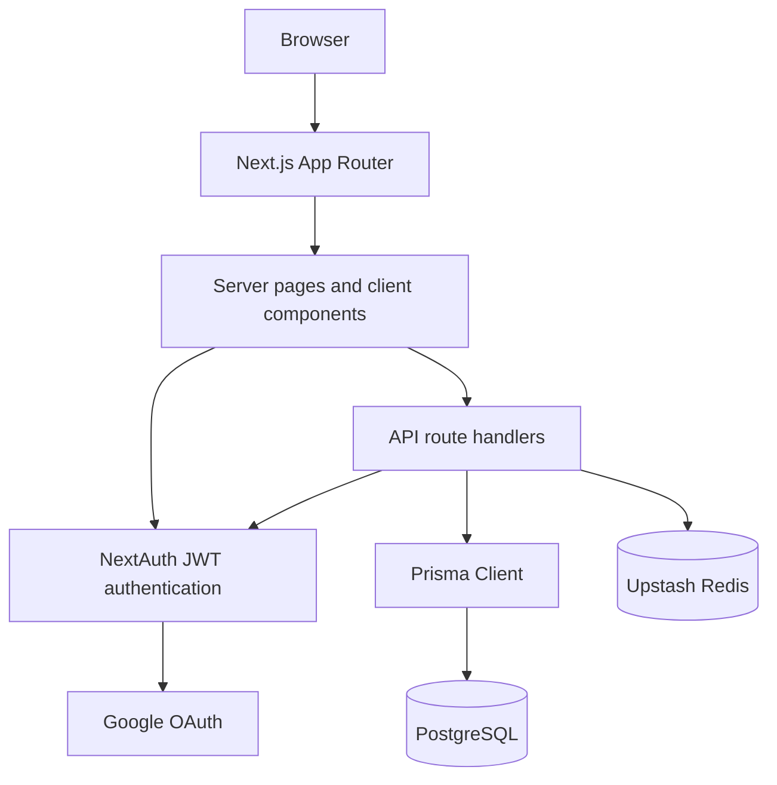

# Architecture

## System overview

Dimovtax is a Next.js application using the App Router. Server components load protected pages and server data. Client components provide interactive tables, forms, navigation, notifications, and comments. API route handlers protect data mutations independently from the page layer.

## Main components

### Next.js App Router

The `src/app` directory owns pages, layouts, route groups, and API handlers.

The `(auth)` route group contains sign in and sign up pages. The `(root)` route group contains protected dashboard pages, including projects, users, profiles, and project details.

### Authentication

NextAuth is configured in `src/lib/auth.config.ts` and exported through `src/lib/auth.ts`.

The application uses JWT sessions. The JWT includes the user ID, name, email, image, and role. The proxy protects browser routes, while each API mutation performs its own authentication and authorization check.

### Database access

`src/lib/db.ts` exports the Prisma Client singleton. Prisma maps the application models to PostgreSQL.

The primary models are:

1. `User`
2. `Project`
3. `Notification`
4. `Comment`

### Redis caching

Project list responses use Upstash Redis. Cache keys distinguish all project lists, user project lists, and the dashboard limited list. Project create, update, and delete operations invalidate affected cache keys.

Notifications are read directly from PostgreSQL. The notification bell refreshes on demand and periodically rather than using a real time transport.

### User interface

Reusable UI primitives are under `src/components/ui`. Dashboard components are grouped under `src/components/dashboard`, `src/components/projects`, `src/components/users`, and `src/components/navigation`.

Tailwind CSS supplies styling. TanStack Table supplies project and user table behavior. Recharts supplies dashboard charts. Sonner supplies toast feedback.

## Request flow

### Protected page read

1. The browser requests a dashboard page.
2. The proxy checks the session.
3. The server page calls `auth()`.
4. The page loads data through an internal API helper or Prisma.
5. The response is rendered through the App Router.

### Project mutation

1. An admin submits a project form.
2. The API handler authenticates the session and checks the admin role.
3. Zod validates the payload.
4. Prisma writes the project and any related notification in a transaction.
5. Redis project list keys are invalidated.
6. The client refreshes its server data.

### Comment creation

1. An authorized user submits a comment.
2. The API verifies project access and validates the content.
3. Prisma creates the comment.
4. The same transaction creates one notification per distinct recipient.
5. The client adds the returned comment to the current thread.

## Security boundaries

1. The user ID comes from the authenticated session, not from client input.
2. API handlers check authentication independently.
3. Project mutations require an admin role.
4. Comment reads and writes require an admin or the assigned project user.
5. Users can edit only their own comments.
6. Admins can delete any comment.
7. Secrets are supplied through environment variables.
