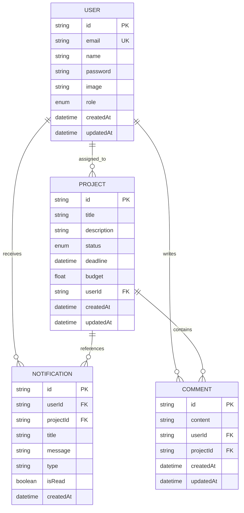

# Database

## Database technology

The application uses PostgreSQL through Prisma ORM. The schema source is [prisma/schema.prisma](prisma/schema.prisma). Migrations are stored in `prisma/migrations`.

## Entity relationship diagram



## Models

### User

The `User` model stores authentication identity, display information, and role.

Important fields:

1. `id`, a generated string primary key.
2. `email`, a unique login identifier.
3. `password`, an optional password hash for credentials users.
4. `role`, either `USER` or `ADMIN`.
5. `image`, an optional profile image.

A user can have assigned projects, notifications, and comments.

### Project

The `Project` model stores the work managed by the application.

Important fields:

1. `title`
2. `description`
3. `status`, either `ACTIVE`, `ON_HOLD`, or `COMPLETED`
4. `deadline`
5. `budget`
6. `userId`, an optional assigned user reference

The status field has an index for project filtering.

### Notification

The `Notification` model stores in app notifications.

Notification types currently include:

1. `PROJECT_ASSIGNED`
2. `PROJECT_STATUS_CHANGED`
3. `NEW_COMMENT`

The compound index on `userId`, `isRead`, and `createdAt` supports unread count queries and recent notification lists.

### Comment

The `Comment` model stores one comment associated with one project and one user.

The index on `projectId` and `createdAt` supports chronological project comment loading.

## Delete behavior

1. Deleting a user cascades to that user's notifications and comments.
2. Deleting a project cascades to its notifications and comments.
3. Removing a project assignment sets the project user reference to null.

## Migration workflow

Local development:

```bash
npx prisma migrate dev
```

Cloud or production deployment:

```bash
npx prisma migrate deploy
```

The application build runs `prisma generate` before Next.js type checking. This keeps the generated client aligned with the committed schema.
